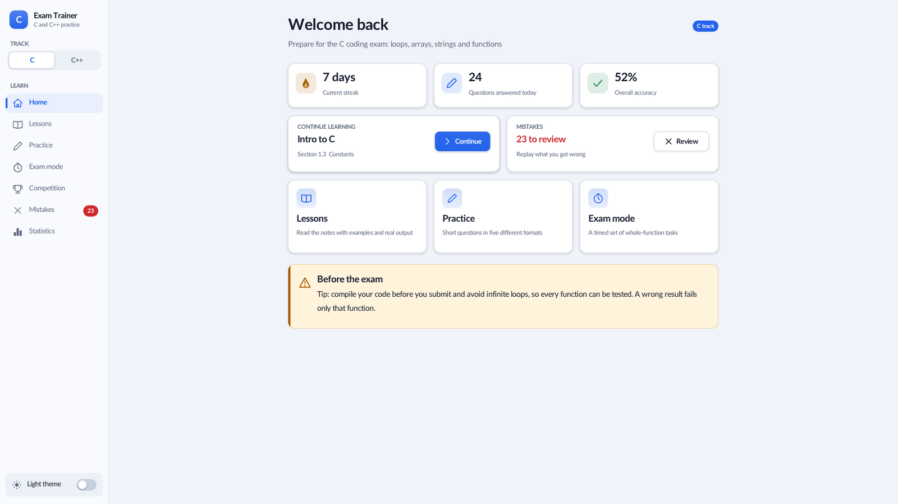
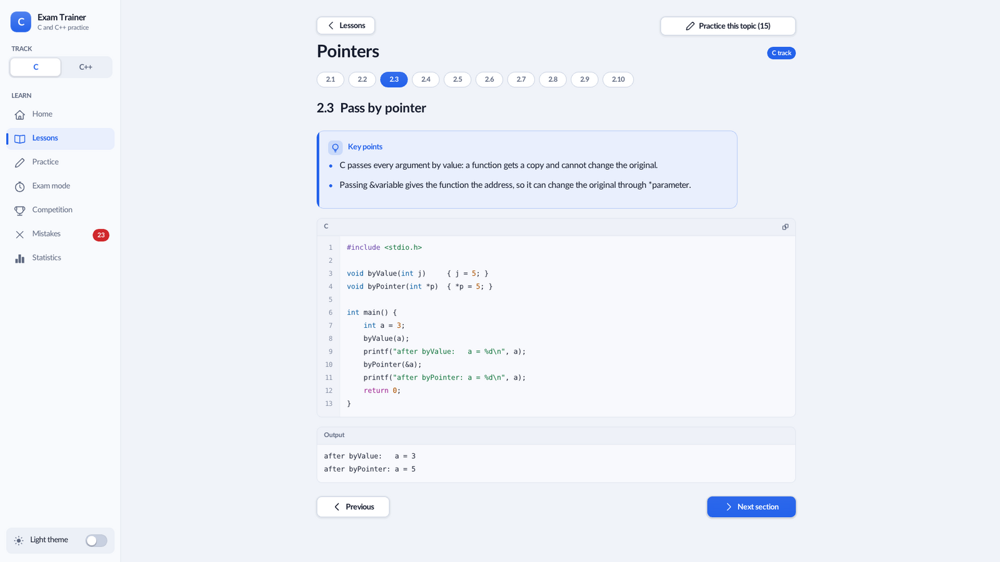
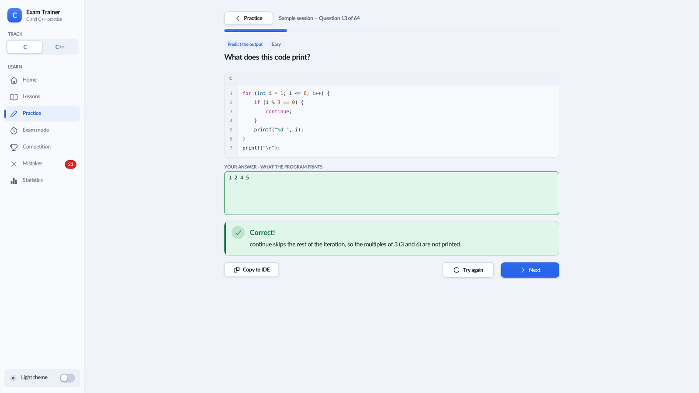
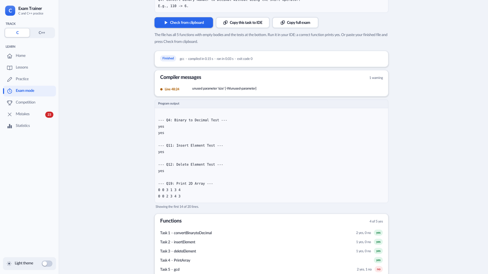
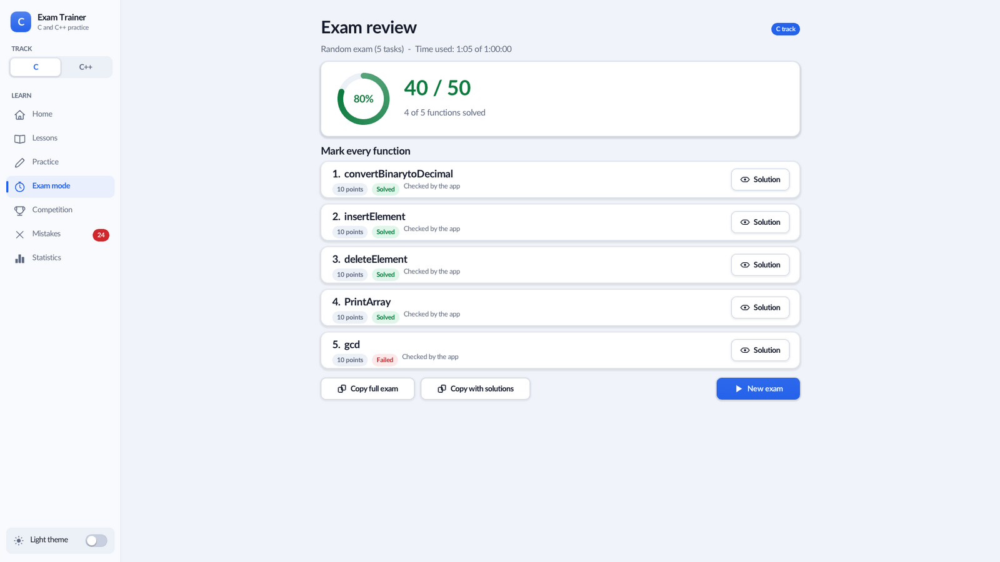
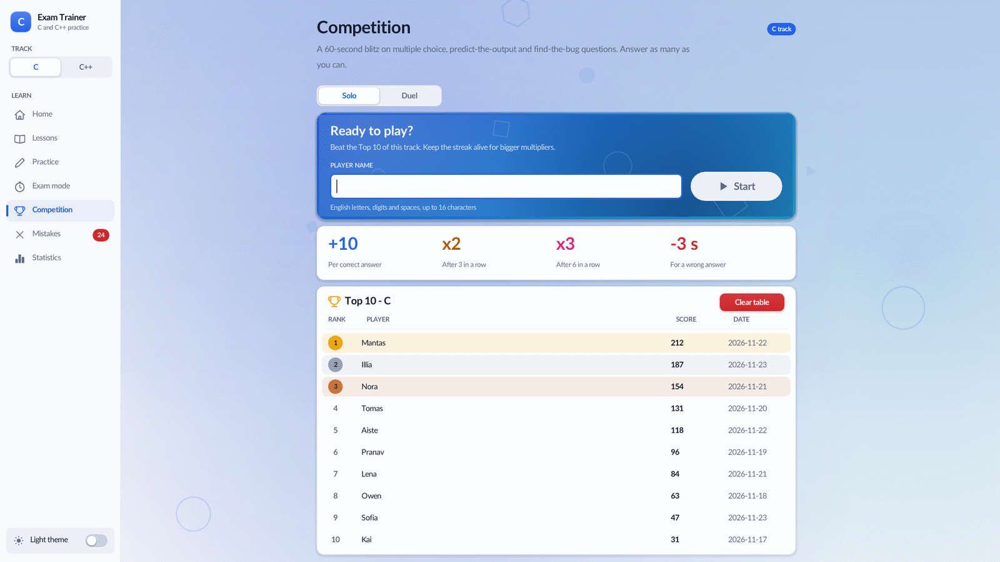
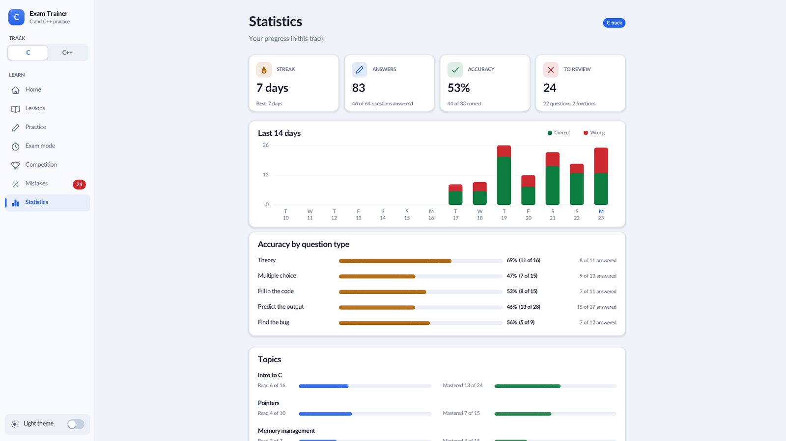

# C and C++ Exam Trainer

An interactive desktop app for practising for C and C++ coding exams: lessons, short questions and timed whole-function exams in one place.



## Overview

Exam Trainer helps students prepare for a university coding exam in C or C++. It combines the lecture material with practice:
you read a short lesson, answer questions on the topic, and then rehearse the real exam format, where you write several complete
functions in your own IDE and the tests run at the bottom of the file.

The app is meant for first- and second-year programming students who need to revise pointers, memory, arrays, strings and
classes before an exam, and who want quick feedback without setting up anything beyond the app itself. It works offline: there
is no account, no network access at run time and no server.

## Features

**Two separate tracks.** Switch between C and C++ with one toggle. The tracks never mix: each has its own lessons, questions,
exam tasks, progress and Top 10, and its own accent colour.

**Lessons.** Lecture notes split into short sections with key points, syntax-highlighted code and the real program output.
The app remembers which sections you have read and offers to continue where you stopped.

**Five question types.** Every topic has practice questions in five formats:

- Theory: a short typed answer
- Multiple choice
- Fill in the code
- Predict the output
- Find the bug (click the faulty line, then type the fix)

Answers can have several accepted variants, and every question has an explanation. A Copy to IDE button puts the code of a
question on the clipboard so you can try it yourself.

**Exam mode.** A timed set of whole-function tasks, like the real coding exam.

- Start a quick exam with 3, 5 or 8 random functions and a time limit, or take one of the original papers.
- Copy this task to IDE or Copy full exam puts the file with the empty functions and the tests at the bottom on the clipboard.
- Check from clipboard compiles and runs the file you copied back, and marks every function from the real program output.
  You can also mark functions as Passed or Failed yourself.
- Scoring is per function: every passed function gives its points, and a failed one only affects that function.
- The review lists every function with its mark and the reference solution, and can copy the exam with solutions.

**Mistakes.** Every wrong answer and failed function is collected on one screen, where you can replay them until you get them right.

**Statistics.** Streak, answers per day for the last 14 days, accuracy by question type, and read and mastered counts for each topic.

**Competition.** A 60-second blitz on multiple-choice, predict-the-output and find-the-bug questions, with combo multipliers,
rank titles and a Top 10 per track. A two-player Duel on the same questions keeps a head-to-head history.

**Light and dark themes.** One toggle in the sidebar switches the whole app.

### Gallery

| | |
|---|---|
|  |  |
| Lesson: key points, highlighted code and output | Practice question: predict the output |
|  |  |
| Exam run: result of Check from clipboard | Exam review with per-function marks |
|  |  |
| Competition: Top 10 | Statistics |

## How it works

- **Language and graphics.** C++20 with [Raylib](https://www.raylib.com/) 6.2 (pinned release). The window is 1280x720 by default,
  resizable down to 960x600, at 60 FPS.
- **Content as text files.** Lessons, questions and exam tasks live in `content/c` and `content/cpp` as plain text. A parser
  reads them when the app starts, so content can be added or fixed without rebuilding. Problems found while loading are
  printed to the console and checked by the tests.
- **Answer checking.** A question can list several accepted answers separated by `|`. Answers are compared after trimming and
  collapsing whitespace.
- **Local progress.** Answers, exam results, streak, Top 10 and settings are stored in a small text file (`progress.txt`) in the
  per-user data directory, with a fallback folder next to the executable. Set `LEARN_C_CPP_DATA` to use another folder.
- **Runner.** Check from clipboard uses the system compiler (gcc or g++) to build the pasted file (`-Wall -Wextra`, C11 or
  C++20) and runs the result with a 3 second limit. It is the only part of the app that starts other processes.
- **Testable logic.** Everything that does not draw (parser, answer checking, exam assembly, exam checking, progress,
  statistics, runner, leaderboard) is independent of Raylib and covered by unit tests.
- **Own UI toolkit.** Buttons, cards, tabs, progress bars, text inputs and the monospaced code box are shared widgets that take
  their colours, sizes and motion from one theme module with a light and a dark palette.

### Project structure

```
assets/fonts/        Lato (UI) and DejaVu Sans Mono (code)
content/
  c/                 C track: lessons/, exercises/, exams/
  cpp/               C++ track: lessons/, exercises/, exams/
docs/
  CONTENT_FORMAT.md  format of the content files
  screenshots/       images used in this README
src/
  app/               application object, navigation, page registry
  content/           content types, parser and loader
  logic/             answer checking, exams, runner, progress, statistics, competition (no Raylib)
  platform/          resource and user-data paths
  screens/           one file per page
  ui/                theme and widget toolkit
tests/               unit tests
tools/               export_content: dumps runnable snippets for compile checks
CMakeLists.txt       cross-platform build (Raylib via FetchContent)
Makefile             Linux build
```

## Getting started

### Requirements

- A C++20 compiler (GCC or Clang on Linux and macOS, MSVC or MinGW on Windows)
- Git and an internet connection for the first build: Raylib 6.2 is downloaded then. After that the app needs no network.
- Make (Linux) or CMake 3.22 or newer
- On Linux, the development packages that Raylib needs, for example on Debian or Ubuntu:
  `libgl1-mesa-dev libx11-dev libxrandr-dev libxinerama-dev libxcursor-dev libxi-dev`
- A system `gcc` and `g++` on the PATH, only for Check from clipboard (the rest of the app works without them; the app has a
  button to detect the compilers again)

The app is developed and tested on Linux. The Windows and macOS builds use the same CMake project but have not been tested.

### Build with make (Linux)

```
make            # builds the app; the first run clones and builds Raylib
make run        # builds and starts the app
make test       # builds and runs the unit tests
make clean      # removes the build output but keeps the Raylib checkout
```

The executable is `build/learn-c-cpp`.

### Build with CMake (Linux, Windows, macOS)

```
cmake -S . -B build-cmake
cmake --build build-cmake --config Release
ctest --test-dir build-cmake -C Release     # unit tests
```

CMake downloads Raylib with FetchContent. The assets and content are copied next to the executable, so it can be started from
the build folder: `./build-cmake/learn-c-cpp` on Linux and macOS, `build-cmake\Release\learn-c-cpp.exe` with Visual Studio.

Some of the unit tests compile and run small programs, so they need `gcc` and `g++`; without them these tests are skipped.

## Adding content

Lessons, questions and exam tasks are text files with simple `@directive` blocks. The syntax and a short example of every file
type are in [docs/CONTENT_FORMAT.md](docs/CONTENT_FORMAT.md).

## Team

Illia Karban and Mantas Bielevicius. University group project 2.
